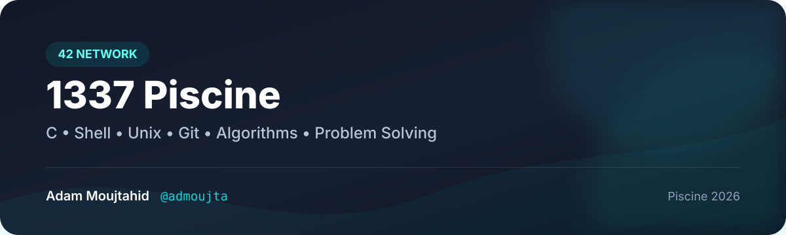

<p align="center">
  
</p>

<h1 align="center">🏊 1337 Piscine — 42 Network</h1>

<p align="center">
  <strong>My intensive 1337 / 42 Piscine journey through C, Shell, Unix, Git, algorithms, and problem solving.</strong>
</p>

<p align="center">
  <a href="https://github.com/admoujta/1337-Pool"></a>
  
  
  
  
</p>

<br/>

<div align="center">
  <h2>👤 Piscine Profile</h2>
  <p><strong>Adam Moujtahid</strong> · <code>admoujta</code></p>

  <table>
    <tr>
      <td align="center"><strong>⭐ Evaluation points</strong><br/><br/><b>5</b></td>
      <td align="center"><strong>🎓 Cursus</strong><br/><br/><b>C Piscine</b></td>
      <td align="center"><strong>🏷️ Grade</strong><br/><br/><b>Pisciner</b></td>
      <td align="center"><strong>📈 Level</strong><br/><br/><b>9 — 36%</b></td>
    </tr>
  </table>
</div>

---

## ✨ About This Repository

This repository documents the work I completed during my **1337 Piscine**, part of the **42 Network** learning model.

The Piscine is an intensive, practice-driven programming experience focused on building strong fundamentals through daily exercises, debugging, peer learning, evaluations, and independent problem solving.

> **Core focus:** understanding how programs work, writing clean C code, mastering the Unix environment, and developing strong algorithmic thinking.

---

## 📌 Piscine Snapshot

| Item | Details |
|---|---|
| 🏫 School | 1337 — 42 Network |
| 👨‍💻 Student | Adam Moujtahid |
| 🧾 GitHub | [`@admoujta`](https://github.com/admoujta) |
| 🎓 Cursus | C Piscine |
| 🏷️ Grade | Pisciner |
| 📅 Session | 2026 |
| 🧠 Main focus | C, Shell, Unix, Git, algorithms, problem solving |

---

## 🗂️ Repository Roadmap

```text
1337-Pool/
│
├── shell00/   → Unix basics, permissions, files, Git
├── shell01/   → Shell scripting and command-line practice
│
├── C00/       → First C programs, loops, conditions, output
├── C01/       → Pointers, arrays, memory addresses
├── C02/       → Strings and character validation
├── C03/       → String comparison, concatenation, search
├── C04/       → atoi, bases, strings, integer output
├── C05/       → Recursion, Fibonacci, sqrt, prime numbers
├── C06/       → argc, argv, argument sorting
├── C07/       → malloc, strdup, split, ranges, joins
├── C08/       → Headers, structures, typedef
├── C09/       → Libraries, Makefile, compilation
├── C11/       → Function pointers and higher-order functions
│
├── assets/
│   ├── 1337-piscine-banner.svg
│   └── adam-moujtahid.jpg
│
└── README.md
```

---

## 🐚 Shell Modules

### Shell00

The first step into the Unix environment.

**Main topics:**

- Unix/Linux commands
- File and directory manipulation
- Permissions
- `find`
- Git basics
- SSH basics
- Environment awareness

### Shell01

A deeper introduction to shell tools and command composition.

**Main topics:**

- Shell scripting
- `grep`
- `sed`
- `awk`
- Pipes and redirections
- Environment variables
- Command-line problem solving

---

## 💻 C Modules

| Module | Focus | Key concepts |
|---|---|---|
| `C00` | C fundamentals | `write`, loops, conditions, character and number output |
| `C01` | Pointers | addresses, swap, arrays, pointer manipulation |
| `C02` | Strings | copy functions, validation, string manipulation |
| `C03` | String algorithms | compare, concatenate, search, `ft_strlcat` |
| `C04` | Conversion | `ft_atoi`, bases, `ft_putnbr`, `ft_putstr` |
| `C05` | Recursion & maths | factorial, power, Fibonacci, sqrt, primes |
| `C06` | Program arguments | `argc`, `argv`, sorting arguments |
| `C07` | Dynamic allocation | `malloc`, `ft_strdup`, ranges, join, split |
| `C08` | C structures | headers, `struct`, `typedef`, arrays of structures |
| `C09` | Libraries | `libft.a`, `ar`, `ranlib`, Makefile |
| `C11` | Function pointers | `ft_foreach`, `ft_map`, `ft_any`, sorting callbacks |

---

## 🧠 Skills Developed

The Piscine helped me build and reinforce:

- **C programming fundamentals**
- **Algorithmic thinking**
- **Problem solving under constraints**
- **Pointers and memory management**
- **Dynamic memory allocation**
- **Recursion**
- **String manipulation**
- **Function pointers**
- **Unix / Linux command line**
- **Shell scripting**
- **Git and version control**
- **Compilation and Makefiles**
- **Debugging discipline**
- **Code readability and style rules**
- **Independent learning and peer evaluation**

---

## 🛠️ Tech Stack

<p align="center">
  
</p>

<p align="center">
  <code>C</code> • <code>Bash</code> • <code>Unix/Linux</code> • <code>Git</code> • <code>GitHub</code> • <code>Make</code>
</p>

---

## ⚙️ Compile & Run

Most C exercises can be compiled with:

```bash
cc -Wall -Wextra -Werror file.c
```

Run the generated executable:

```bash
./a.out
```

For projects that contain a `Makefile`:

```bash
make
```

Useful Makefile commands:

```bash
make clean
make fclean
make re
```

---

## 🧪 Norminette

The code follows the style constraints used at **42 / 1337**.

To check a file or directory:

```bash
norminette
```

A valid solution is not only expected to work — it should also respect the required coding style and project constraints.

---

## 🔍 What This Piscine Taught Me

The most valuable part of the Piscine was not memorizing functions. It was learning how to approach a problem systematically:

```text
Read the subject
      ↓
Understand the constraints
      ↓
Break the problem into smaller steps
      ↓
Implement
      ↓
Compile with strict flags
      ↓
Test edge cases
      ↓
Debug
      ↓
Improve
```

That workflow continues to shape the way I approach larger software projects today.

---

## 🎯 Purpose

I keep this repository as a record of my progress during the **1337 Piscine** and as a reference for the core concepts I practiced throughout the experience.

It represents the transition from writing simple programs to thinking more carefully about:

- how memory is used;
- how strings and arrays work internally;
- how functions communicate through pointers;
- how algorithms behave on edge cases;
- how Unix tools can simplify development;
- and how disciplined debugging leads to better code.

---

## ⚠️ Academic Integrity

This repository is shared for **educational and personal portfolio purposes**.

If you are currently taking part in a **42 / 1337 Piscine**, use repositories like this only as inspiration after making a serious attempt yourself. The real value of the Piscine comes from struggling with the problem, debugging it, and understanding why the final solution works.

<p align="center">
  <strong>Learn • Understand • Code • Debug • Repeat</strong>
</p>

---

## 👨‍💻 Author

<p align="center">
  
</p>

<h3 align="center">Adam Moujtahid</h3>

<p align="center">
  <strong>1337 / 42 Network — C Piscine</strong><br/>
  <code>admoujta</code><br/><br/>
  <a href="https://github.com/admoujta">GitHub</a>
</p>

<p align="center">
  ⭐ If this repository helps you understand my journey, feel free to explore the exercises and projects.
</p>
